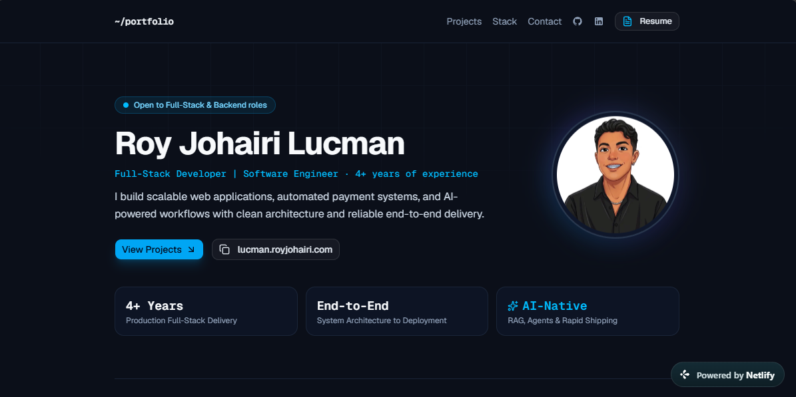

# Personal Developer Portfolio

My personal developer portfolio showcasing full-stack engineering case studies, system architectures, and core technical capabilities.

[](https://royjohairil.netlify.app/)




## ✨ Highlights

- **Static-First Performance:** Pre-rendered case study pages (`generateStaticParams`), optimized `next/image` assets, and zero layout shift with `next/font`.
- **Interactive Dark-Slate UI:** Custom cursor-tracking `SpotlightCard` components, smooth CSS micro-animations, and accessible `shadcn/ui` primitives.
- **Data-Driven Architecture:** All projects, metrics, and tech ecosystems live in a single strongly-typed `portfolio.ts` config for effortless updates.
- **SEO & Social Ready:** Dynamic per-project OpenGraph metadata, custom favicons, and `1200×630` preview cards.

## 🛠️ Tech Stack

- **Framework:** Next.js (App Router) & TypeScript
- **Styling & UI:** Tailwind CSS v4, shadcn/ui, Lucide Icons
- **Hosting & CI/CD:** Netlify

## 📂 Project Structure

```text
src/
├── app/
│   ├── layout.tsx              # Global dark-slate layout, fonts, and SEO metadata
│   ├── page.tsx                # Main landing view (Hero, Projects, Principles, Stack, Contact)
│   └── projects/
│       ├── page.tsx            # Full project archive
│       └── [slug]/page.tsx     # Static case-study pages with dynamic metadata
├── components/                 # Modular UI sections and interactive Spotlight cards
└── data/
    └── portfolio.ts            # Strongly-typed content configuration
```

---

*Designed and built from scratch to showcase production full-stack engineering work. View the live site at [https://royjohairil.netlify.app/](https://royjohairil.netlify.app/).*